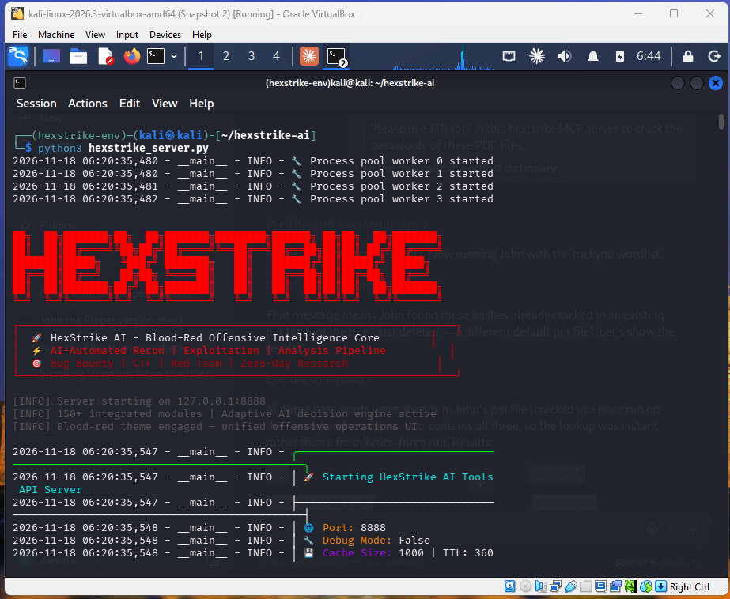
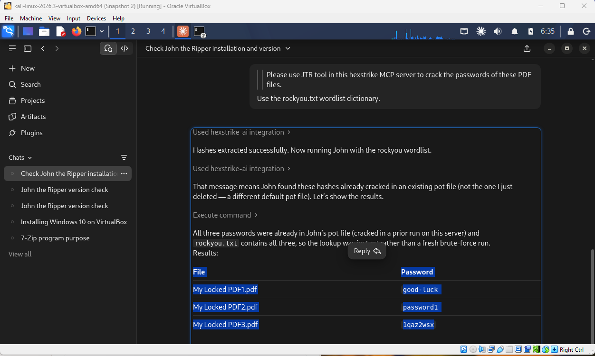

# Password-Hash-Extraction-and-Cracking-Using-John-the-Ripper-JtR-and-AI
Cybersecurity with Networkwalks, Week 3
# Project Overview

This project explores AI-assisted password recovery using John the Ripper (JtR), Hexstrike-AI, and Claude Desktop in a Kali Linux virtual machine.

The objective was to configure an AI-assisted cybersecurity environment and use it to extract password hashes from three password-protected PDF files and perform password-cracking attempts.

# Lab Environment

Operating System: Kali Linux (Virtual Machine)

AI Assistant: Claude Desktop

MCP Server: Hexstrike-AI

Password Cracking Tool: John the Ripper (JtR)

Protocol: Model Context Protocol (MCP)

# Task 1: Setting Up Hexstrike-AI MCP Server with Claude Desktop

# Step 1: Install Claude Desktop on Kali Linux

Download and install Claude Desktop using the following commands.

Add the GPG key:

	curl -fsSL https://pkg.claude-desktop-debian.dev/KEY.gpg | sudo gpg --dearmor -o /usr/share/keyrings/claude-desktop.gpg

Add the repository:

	echo "deb [signed-by=/usr/share/keyrings/claude-desktop.gpg arch=amd64,arm64] https://pkg.claude-desktop-debian.dev stable main" | sudo tee /etc/apt/sources.list.d/claude-desktop.list

Update package lists and install Claude Desktop:

	sudo apt update
	sudo apt install claude-desktop

# Step 2: Download and Configure Hexstrike-AI

Clone the Hexstrike-AI GitHub repository:

	git clone https://github.com/0x4m4/hexstrike-ai.git
	cd hexstrike-ai

Create a Python virtual environment:

	python3 -m venv hexstrike-env

Activate the virtual environment:

	source hexstrike-env/bin/activate

Install the required Python dependencies:

	pip3 install -r requirements.txt

# Step 3: Start the Hexstrike-AI Server

Navigate to the project directory, activate the virtual environment, and start the server:

	cd ~/hexstrike-ai
	source hexstrike-env/bin/activate
	python3 hexstrike_server.py

# Step 4: Configure the MCP Server in Claude Desktop

Edit the Claude Desktop MCP configuration file and add the following configuration:

	  {
	    "mcpServers": {
	      "hexstrike-ai": {
	        "command": "/home/kali/hexstrike-ai/hexstrike-env/bin/python",
	        "args": [
	          "/home/kali/hexstrike-ai/hexstrike_mcp.py",
	          "--server",
	          "http://localhost:8888"
	        ]
	      }
	    }
	  }

Refer to the Hexstrike-AI GitHub repository for configuration instructions.

# Task 2: Password Hash Extraction and Cracking Using John the Ripper (JtR) and AI

# Lab Environment

Hexstrike-AI MCP Server

Claude Desktop

Kali Linux Virtual Machine

John the Ripper (JtR)

# Objective

Extract password hashes from three password-protected PDF files and use John the Ripper to perform password-cracking attempts.

Claude Desktop was used to interact with the Hexstrike-AI MCP server through prompts, assisting with the password recovery workflow.

# Key Activities

Extract password hashes from three PDF files.

Use John the Ripper to attempt to crack the extracted hashes.

Interact with AI-assisted security tools using Claude prompts.

Review and document the password-cracking results.

# Results:
# Hashes calculated:

|        File        |                MD5               |                     SHA1                 |                                 SHA256                           |
|--------------------|----------------------------------|------------------------------------------|------------------------------------------------------------------|
| My Locked PDF1.pdf | 112330f8d73e9f94b7263404799f4a3b | 67cb14f88c84c5cd37f45d74631b915aeb8e4468 | 565843cf47c802ea5b7481d5e24c8e99a6a3f8a9eb861ef71bc0b1180be50e4e |
| My Locked PDF2.pdf | 5721116255bd95a1bbbcefedae2e5968 | 03f9c6b874ea628475d54e52c1e0b99dd83e7e6b | a7ac5ab8e90e239b9022737b644b4f5469024b2384a722d9113490efcf46a212 |
| My Locked PDF3.pdf | c9f461d51bee9119d1fddbcf5046e5a6 | 2802a83fc1ca93e34e1f81de4467ab2ab84668fa | c506c362d1e8175be8fe91b5a145cec2aeee4ce22f54e426cecf7e5e17fe58a5 |

# Passwords cracked:

|        File        |     Password        |
|--------------------|---------------------|
| My Locked PDF1.pdf |    good-luck        |
| My Locked PDF2.pdf |    password1        |
| My Locked PDF3.pdf |    1qaz2wsx         |

# Project Screenshots

1. 

2. MCP Connection

3. PDFs Hash Extraction

4. 

5. PDF1 Capture the Flag

6. PDF2 Capture the Flag

7. PDF3 Capture the Flag
